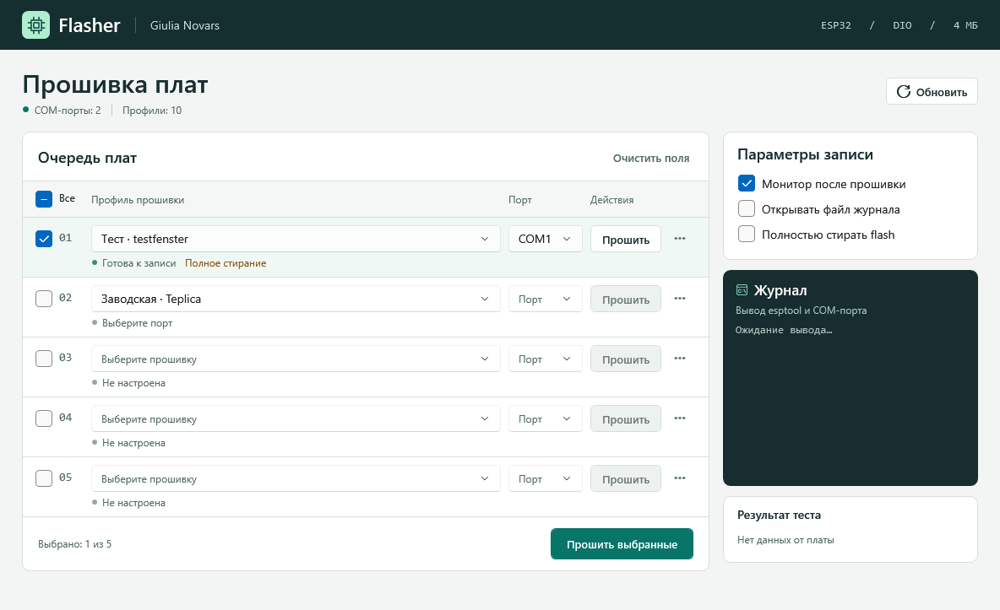

# Flasher

Windows-программа для записи готовых заводских и тестовых прошивок на платы ESP32 и Green2 на ESP32-C6. В этом репозитории находятся исходники WPF-приложения, готовая программа, описания комплектов, образы и esptool.



## Запуск на рабочем месте

1. Установите **.NET Desktop Runtime 10 x64** для Windows. На машине разработчика с .NET 10 SDK и установленным Windows Desktop Runtime всё готово.
2. Запустите `WpfApp1.exe` из корня репозитория или из полной папки публикации.
3. Подключите плату по USB и нажмите «Обновить». В одной строке выберите профиль и COM-порт. Сверьте модель платы и назначение профиля.
4. Нажмите «Прошить». Для партии отметьте нужные строки с разными портами или нажмите «Все», чтобы выбрать готовые строки. Нажмите «Прошить выбранные». Программа выполняет задания последовательно. Статус «Прошито» означает, что esptool завершился с кодом 0.
5. Для чтения вывода платы включите «Монитор после прошивки» или откройте «…» в нужной строке и выберите «Монитор порта». Скорость — 115200 бод. В партии монитор открывается для каждой успешно прошитой платы. «Обновить» сохраняет действующие мониторы и выбор временно отключённых портов. Панель результата распознаёт сообщения тестов Fenster, Teplica, Fan и регистрации Green2 и подписывает их портом и профилем.
6. В меню строки «Журнал последней записи строки» открывает файл её последней попытки, в том числе после перезапуска программы. Все журналы сохраняются раздельно в `%LOCALAPPDATA%\Flasher\logs`. Каждый содержит профиль, порт, время, вывод esptool и итог. При повторном использовании порта прежняя запись остаётся в истории.
7. После успешной записи SmartKitchen или SmartKitchen2 и чтения MAC меню строки открывает локальный пресет для этой платы. «Сохранить пресет» записывает его в `%LOCALAPPDATA%\Flasher\presets`. В SmartKitchen2 первый выход освещения нужно указать по разводке платы. Пресет можно использовать как локальную запись конфигурации. Программа не передаёт его на плату.

«Полностью стирать flash» включает полное стирание flash, включая сохранённые настройки платы. Профили **testfenster**, **testteplica** и **testgreen2** всегда выполняют полное стирание. Для **testirovanieFan** успешный тест запускает на самой плате попытку загрузить рабочую прошивку Fan по HTTP. Эти особенности указаны в списке выбора.

## Каталог

| Назначение | Профили |
| --- | --- |
| Заводские | Fan, fenster2, SmartKitchen2, Teplica |
| Заводские для прежней интеграции Google IoT Core | Co2Sta, SmartKitchen |
| Тестовые | TEST, testfenster, testteplica, testirovanieFan, testgreen2 |

Готовые комплекты находятся в `projects/<профиль>/`. Исходники четырёх тестовых прошивок хранятся в `projectsard/`.

| Профиль Flasher | Arduino-скетч | Дополнительные библиотеки |
| --- | --- | --- |
| testfenster | [fenster2_testprosh.ino](projectsard/fenster2_testprosh/fenster2_testprosh.ino) | INA226 0.6.6 (Rob Tillaart) |
| testteplica | [teplica2_testprosh.ino](projectsard/teplica2_testprosh/teplica2_testprosh.ino) | INA219 0.4.2 (Rob Tillaart), OneWire 2.3.8, DallasTemperature 4.0.6 |
| testirovanieFan | [testirovanieFan.ino](projectsard/testirovanieFan/testirovanieFan.ino) | DFRobot_SHT20, Adafruit_CCS811 |
| testgreen2 | [green2_testprosh.ino](projectsard/green2_testprosh/green2_testprosh.ino) | ArduinoJson 7.4.3 |

**Green2:** [инструкция регистрации и сборки](projectsard/green2_testprosh/README.md).
Профиль `testgreen2` предназначен для ESP32-C6 с 8 МБ. Моторы выключены, ток не
измеряется; регистрация запускается удержанием SYNC 2 секунды или `@g register`
в Arduino Serial Monitor. Само включение не регистрирует устройство. Оба типа —
родитель и `GN_<mac>_1` — `green2`. Профиль всегда полностью стирает flash перед
записью. Каждый запуск регистрации перезаписывает серверную конфигурацию заводскими
значениями и сбрасывает владельца в `0`, без предварительной проверки старой записи.
Нужна новая сборка Flasher; автономная поставка создаётся командой
`dotnet publish src/Flasher/Flasher.csproj -c Release --self-contained true -o publish/green2`.

У теста вентилятора описание и готовый образ лежат рядом со скетчем. Для первых двух скетчей в Arduino IDE выберите **ESP32 Dev Module**, flash 4 МБ, частоту flash 80 МГц, режим QIO и схему **Minimal SPIFFS (1.9MB APP with OTA/128KB SPIFFS)**. Эти параметры взяты из исходных экспортов Arduino. Параметры записи esptool из тех же экспортов — DIO, 80 МГц, 4 МБ. Из корня репозитория можно проверить сборку командами ниже, установив ядро esp32 3.3.12 и библиотеки из таблицы.

```powershell
arduino-cli compile --fqbn esp32:esp32:esp32:FlashMode=qio,FlashFreq=80,FlashSize=4M,PartitionScheme=min_spiffs projectsard/fenster2_testprosh
arduino-cli compile --fqbn esp32:esp32:esp32:FlashMode=qio,FlashFreq=80,FlashSize=4M,PartitionScheme=min_spiffs projectsard/teplica2_testprosh
```

В профили перенесены готовые экспорты из истории Giulia-Novars-Smart. Для Fenster скетч и экспорт соответствуют ревизии `386acd2`. Для Teplica экспорт взят из `c2df0c5`, а скетч — из последующей `0d84b5c`, где добавлена передача измеренной температуры в отчёте. Чтобы использовать эту правку на стенде, потребуется отдельно выпустить и проверить новую сборку. Оба скетча содержат настройки Wi-Fi стенда.

## Сборка и поставка

Из корня репозитория на Windows x64 с .NET 10 SDK выполните команды ниже. Первое восстановление зависимостей использует NuGet.

```powershell
dotnet build Flasher.sln -c Release
dotnet publish src/Flasher/Flasher.csproj -c Release -o publish
.\publish\WpfApp1.exe
```

Регрессионные проверки запускаются командой `dotnet run --project tests/Flasher.Checks -c Release` на Windows. Они используют копии комплектов, имитацию COM-портов и процесса записи, проверяют очередь WPF и локальные пресеты.

Для передачи на стенд используйте всю папку `publish`. При подготовке новой поставки публикуйте в пустой каталог, чтобы исключённые из выпуска прошивки не остались в меню. Исходный проект открыт через `Flasher.sln`. Исходники находятся в `src/Flasher/`. Готовый EXE в корне сохраняет привычное имя.

## Добавление прошивки

Создайте папку в `projects/` и поместите в неё приложение, загрузчик и таблицу разделов от одной сборки. Скопируйте структуру `projects/TEST/ino.json`. Поле `nameDir` должно совпадать с именем папки. Укажите локальные имена файлов в `binname`, `bootloader` и `partitions`. Значение `kind` — `factory` или `test`. Поле `erase: true` включает полное стирание при каждом запуске профиля. Для обычного комплекта поле `layout` не требуется.

Без новых полей программа использует карту классического ESP32 с flash 4 МБ,
DIO, 80 МГц и esptool 3.1. Адрес загрузчика — `0x1000`, таблицы — `0x8000`,
начальных данных OTA — `0xe000`, приложения — `0x10000`.
Для Green2 задаются `chip: "esp32c6"` и `flashSize: "8MB"`: загрузчик записывается
по `0x0`, используется отдельный `partsheme/esptool-c6.exe` версии 5.3.1.
Прочие сочетания чипа и размера flash отклоняются; C6 не может использовать
старую схему `layout`. При запуске из корня нажмите «Обновить» после изменения
каталога. При обновлении каталога и перед записью программа проверяет целевой
чип, заголовки, границы сегментов, контрольные суммы образов, таблицу разделов,
соответствие приложения размеру раздела и общие начальные данные OTA.
Перед первым заданием проверяются все выбранные комплекты. До окончания партии
Windows удерживает их файлы открытыми для чтения. Для стенда из папки публикации
повторите публикацию.

Происхождение исходников, ограничения старых образов, результаты проверок и находки по безопасности приведены в [отчёте об аудите](AUDIT.md).
